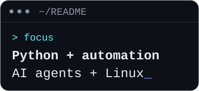
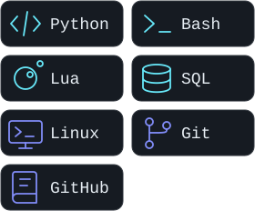

<picture>
  <source media="(prefers-color-scheme: light)" srcset="assets/header-light.svg">
  
</picture>

# Otavio Alves

## About me

I enjoy building practical tools with Python and automating everyday workflows. My current interests include AI, agents, and orchestration: exploring how to connect models, tools, and useful automation.

Linux is central to my workflow. I enjoy configuring Arch Linux, Hyprland, and Neovim, writing shell scripts, and learning from open source. I'm also interested in SQL and databases.

## Tech stack

<!-- Local, original pictograms; labels describe technologies, not proficiency levels. -->
<picture>
  <source media="(prefers-color-scheme: light)" srcset="assets/stack-light.svg">
  
</picture>

**Development** — Python, Bash, Lua, SQL

**Environment & workflow** — Linux, Git, GitHub

## Featured projects

### [dotfiles](https://github.com/otavio-alvxs/dotfiles)

Personal Hyprland and Neovim configuration, including Lua editor settings and a Bash setup script.

`Linux` `Hyprland` `Neovim` `Lua` `Bash`

### [To_Do_List](https://github.com/otavio-alvxs/To_Do_List)

A task management app with a Python/Flask API, SQL persistence, and an HTML, CSS, and JavaScript interface.

`Python` `Flask` `SQL`
